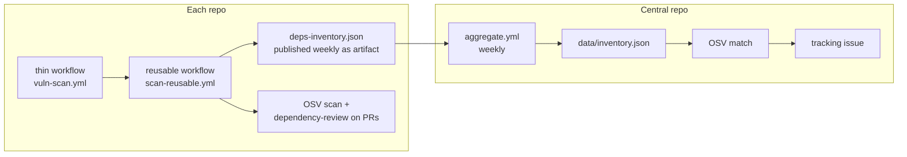

# dependency-inventory

[](https://github.com/reihlinstinct/dependency-inventory/actions/workflows/ci.yml)
[](https://github.com/reihlinstinct/dependency-inventory/actions/workflows/layout.yml)
[](LICENSE)

One place that lists every package used across all reihlinstinct repositories
and matches it against known-vulnerability databases (OSV, which includes the
GitHub Advisory Database), so a published CVE maps straight to the repos that
need a fix.

## What it does

1. **Collects** an inventory from every repo: ecosystem, package, version (or
   version spec), repo, manifest file, and whether the dependency is direct or
   transitive. Sources: `requirements*.txt`, `pyproject.toml`,
   `package.json` + `package-lock.json`, `go.mod`, and GitHub Actions
   referenced in workflows.
2. **Scans** pinned versions against [OSV](https://osv.dev) (batch API) and
   reports ID, CVE aliases, severity, affected locations and fixed versions.
3. **Aggregates weekly** in [`data/inventory.json`](data/inventory.json) and
   opens a tracking issue when new findings appear.

## Architecture



See [docs/DESIGN.md](docs/DESIGN.md) for the full design.

## Usage

Generate an inventory for a checked-out repo:

```sh
python3 tools/generate_inventory.py --repo . --out deps-inventory.json
```

Scan an inventory against OSV:

```sh
python3 tools/scan_inventory.py --inventory deps-inventory.json --out vuln-report.md
```

Add the per-repo scan to any reihlinstinct repo (see docs/DESIGN.md):

```yaml
jobs:
  scan:
    uses: reihlinstinct/dependency-inventory/.github/workflows/scan-reusable.yml@v1
    permissions:
      contents: read
```

## Privacy

This is a public repo. Only public-repo names and dependencies ever appear in
committed data. Private repos are scanned too, but their names and details
never leave the workflow run; committed data contains only public repos.

## API

All tools are stdlib-only CLIs; `tools/generate_inventory.py --help` and
`tools/scan_inventory.py --help` print short usage.
