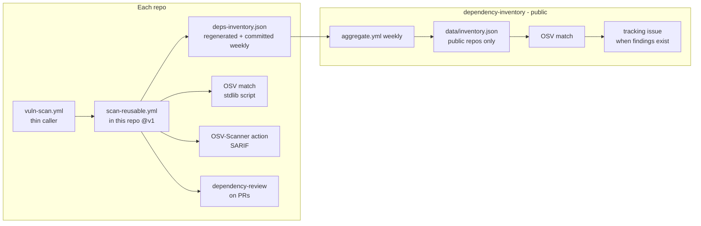

# Design: dependency inventory and vulnerability matching

## Goal

One place that lists every package used across all reihlinstinct repos and
where it is used, so a newly published CVE maps straight to the repos that
need a fix; plus a continuous check that finds known vulnerabilities in what
we use today.

## Architecture



- **Per-repo scan** (user decision 2026-11-08): every repo runs the check
  itself through a thin workflow that calls the reusable workflow
  `scan-reusable.yml` hosted here. The reusable workflow regenerates
  `deps-inventory.json` from manifests and lockfiles (including transitive
  dependencies), scans pinned versions against OSV, runs OSV-Scanner, and on
  PRs runs `actions/dependency-review-action`. Public repos scan on PRs and
  weekly; private repos weekly only (minutes budget).
- **Central aggregation** (weekly): `tools/aggregate.py` collects the org-wide
  inventory through a scoped token, refreshes `data/inventory.json`
  (public repos only), matches against OSV, and maintains a single tracking
  issue. Each repo also commits its own
  `deps-inventory.json` (generated by the shared workflow), which is the
  per-repo record; the central aggregation is the cross-repo view.
- **Dependabot**: vulnerability alerts and security updates are enabled on
  every repo; this repo and the rollout add `dependabot.yml` where missing.
  Dependabot and OSV complement each other: Dependabot reacts to new
  advisories per repo, this system keeps the cross-repo picture in one place.

## Data model

```json
{"ecosystem": "PyPI|npm|Go|GitHub Actions", "package": "name",
 "version": "pinned or null", "spec": "raw spec or null",
 "repo": "owner/name", "file": "manifest path", "direct": true}
```

## Privacy

- This repo is public; committed data contains **public repos only**.
- Private repos are read with a token in Actions secrets; their names and
  package details never enter committed files, logs, or artifacts, only
  aggregate counts (`data/private-summary.json`). Publishing private findings
  is an open question for the owner; default is withhold.
- The org token needs read-only repository access (`REPO_READ_TOKEN`).

## Costs

Everything runs in this public repo's Actions plus public-repo workflows:
free. Private-repo workflows are scheduled weekly (never per-push) and stay
dormant until the Actions minutes reset (2026-12-01).

## Failure handling

- OSV or GitHub API transient errors: retried with backoff (4 attempts).
- The scan never blocks merges on its own; `dependency-review` on PRs is the
  blocking layer (default config), OSV findings surface in the tracking issue.
